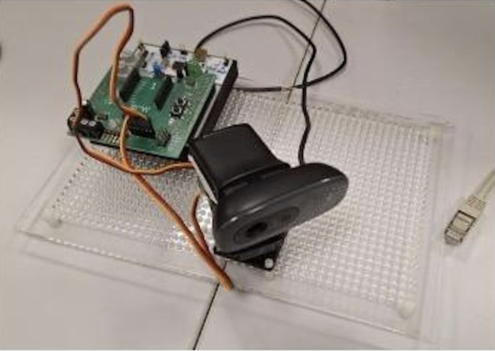

# Raspberry Pi Surveillance Box

Academic embedded systems project developed in 2024 during the second year of a Bachelor's degree in Electrical Engineering and Industrial Computing (BUT GEII).

The project aimed to develop a Raspberry Pi-based surveillance system combining sensor acquisition, GPIO control, serial communication and camera integration.

## Project Overview

The system was designed around a Raspberry Pi 3 connected to an electronic expansion board, a DS1621 temperature sensor, and an STM32 microcontroller for pan-tilt control.

The original project also included plans for a web-based interface, video streaming and wireless network access.

This repository contains the C source files preserved from the original academic project.

## Technologies

- **Programming language:** C
- **Platform:** Raspberry Pi 3, Linux
- **Library:** pigpio
- **Communication protocols:** I²C, UART
- **Microcontroller:** STM32
- **Hardware:** GPIO buttons, LEDs, DS1621 temperature sensor, pan-tilt camera setup

## Source Code

| Directory | File | Description |
|---|---|---|
| `src/gpio/` | `chenillard.c` | Eight-LED sequential lighting routine |
| `src/gpio/` | `boutons.c` | GPIO button input and LED control |
| `src/gpio/` | `PWM.c` | LED brightness control using PWM |
| `src/i2c/` | `ds1621_temperature.c` | DS1621 temperature sensor communication over I²C |
| `src/uart/` | `send_servo.c` | Serial command frame generation for STM32 pan-tilt control |

## Technical Details

### GPIO Control

C programs using the pigpio library to configure Raspberry Pi GPIO pins, read push-button inputs and control LEDs.

### Temperature Acquisition

I²C communication with a DS1621 digital temperature sensor, including conversion commands, register access and temperature data processing.

### UART Communication

A serial communication program designed to transmit pan and tilt commands to an STM32 microcontroller.

The program builds a 12-byte command frame containing two floating-point angles and a checksum, then sends it over a serial connection at 115200 baud.

## Project Status

This repository is an archive of an academic project developed in 2024.

Only part of the original source code has been preserved. The available files document GPIO programming, I²C sensor communication and UART command generation.

The complete web interface, video streaming implementation and Wi-Fi configuration are not included.

The original hardware environment is no longer available for testing. The preserved programs have not been revalidated and may contain unfinished code or implementation errors.

## Academic Context

**Program:** BUT GEII — Electrical Engineering and Industrial Computing  
**Year:** 2023–2024  
**Project:** SAÉ ESE S4 — Raspberry Pi Surveillance Box
